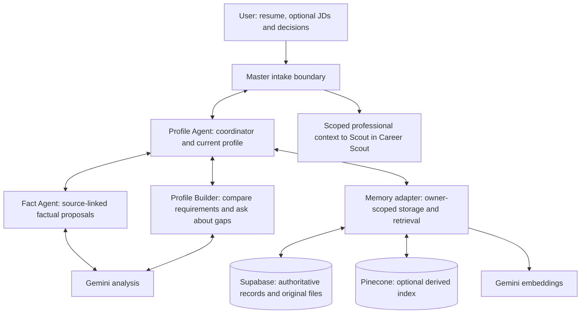

# Career Scout Profile Agent

Runnable Profile Agent, Fact Agent and Profile Builder extracted from [Career Scout](https://github.com/ujjwalbhateja/Career_Scout). Profile turns a resume and optional job descriptions into a source-backed, versioned profile that Master can use. It owns storage and user decisions; its two analysis agents never approve claims themselves.

This repository runs as a **Node.js library, local command-line tool and local Profile webpage**. The webpage uses Career Scout's Profile styling and the standalone agent actions for document intake, Fact review, optional Builder comparison, current-profile handoff and owner-scoped memory. It does not include the original Career Scout Scout or applications screens. Shared modules required by the original implementation remain included to preserve behavior.

## Open the local Profile webpage

Run `./Start-Profile-Agent.ps1` from this folder on Windows, or `npm run web` with Node.js 22.13 or later. The launcher opens the local page on port 5175. If the host is already running, rerunning the launcher opens the existing page. It prints a private browser access link; use that link if the browser does not open automatically. The web host binds only to `127.0.0.1`, resolves its owner from `.env.local`, and rejects requests without its local session cookie. Configure a unique `profile-agent:` owner and Supabase server settings as described in [setup](docs/SETUP.md). Gemini is required for live Fact and Builder analysis. No credentials or existing Career Scout profile are bundled.

The web UI is a Profile-only adaptation of Career Scout's page. Its copied CSS comes from the Career Scout source tree; the browser controller and local HTTP host are new. The older [PDF manual](docs/Career%20Scout%20Profile%20Agent%20Documentation.pdf) documents the initial library/CLI extraction and predates this webpage.

Download the [complete PDF manual](docs/Career%20Scout%20Profile%20Agent%20Documentation.pdf) for the consolidated documentation and rendered diagrams.

## Start here

| Document | Covers |
| --- | --- |
| [Profile Agent documentation](docs/PROFILE_AGENT.md) | Purpose, responsibilities, diagrams, both subagents, evidence, memory, tools and APIs |
| [Setup and operations](docs/SETUP.md) | Installation, configuration, database setup, running the agent, troubleshooting |
| [API and integration](docs/API.md) | Library methods, CLI commands, action contracts and Master handoff |
| [Validation](docs/VALIDATION.md) | Executed checks, preservation evidence and remaining limits |
| [Upstream manifest](UPSTREAM.json) | Source repository, exact source commit and hashes of unchanged files |

## Run without credentials

Install Node.js 22.13 or later, then:

```powershell
npm ci
npm run demo
npm test
npm run verify:upstream
```

The demo uses synthetic facts, a simulated user approval and in-memory storage. It demonstrates verified saving and the current-profile handoff; it does not call Gemini, Supabase or Pinecone. Live operation setup is documented separately.

## Agent structure



Memory supports the two analysis agents through Profile. It is not a third agent that writes experience. The standalone package returns the handoff to its caller; it does not start Scout.

## Preservation and provenance

The 52 source, prompt, migration and regression-test files listed in `UPSTREAM.json` are copied unchanged from Career Scout commit `cedc267896578988c2c4607e5cd0877e45e28f39`. The standalone entry point, CLI, demo and documentation are new. Fact and Profile Builder prompts retain their original paths. Profile and Memory prompts are included as coordinator policy references; the entry point does not send them to a model or interpret them as executable routing.

No existing profile, resume, credentials or database export is included. The CLI and local webpage require a separate `profile-agent:` owner identity and do not load Career Scout's environment file. The local access link is not a hosted-user authentication system; do not publish the local HTTP host on the internet.

There is no license grant added by this extraction. Public repository visibility alone does not grant a software license; upstream and dependency licensing must be respected.
