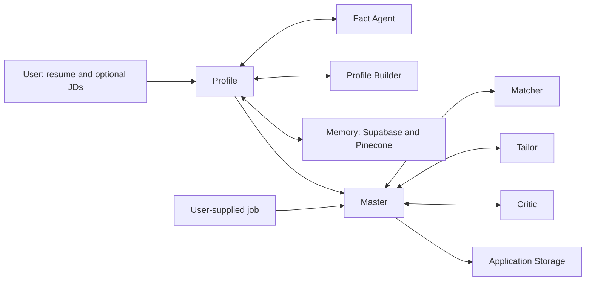

# Career Scout Profile Agent

This repository contains a fork of the Career Scout application in [`career-scout-app/`](career-scout-app/). It keeps the profile journey, source and approval controls, optional JD questionnaires, profile memory, application preparation, review, package storage, architecture view and progress view. The Scout agent, job discovery page and `/api/scout` endpoint have been removed. Application preparation now requires a job supplied by the user.

The original standalone Profile library and its earlier webpage remain at the repository root for source history and CLI use. **The primary website retains the Career Scout name** and is launched by `Start-Profile-Agent.ps1` on port 5176. The earlier root `web/` page on port 5175 is superseded.

## Share the live app

Open [Career Scout](https://career-scout.ujjwalbhateja.chatgpt.site). The public Site asks each visitor to sign in with ChatGPT, then gives them their own private profile and application history. The hosted application uses the existing Supabase project and the configured Gemini/Pinecone providers. Its Matcher, Tailor and Critic run in the hosted Worker; the local launcher uses the Python pipeline. An anonymous HTTPS request was verified to redirect to ChatGPT sign-in. A complete signed-in teacher run has not yet been observed.

## Run on Windows

1. Install Node.js 22.13 or newer and Python with `uv`.
2. In `career-scout-app/`, run `npm ci` and in `career-scout-app/backend/`, run `uv sync --locked`.
3. Copy `career-scout-app/.env.example` to `career-scout-app/.env.local` and configure the same provider settings used by Career Scout. Keep this file private. The browser mock user ID is `profile_agent_local_seedy`, separate from Career Scout's `local_seedy`, so the two sites do not share profile records even when they use the same Supabase project.
4. Run `powershell.exe -NoProfile -ExecutionPolicy Bypass -File .\Start-Profile-Agent.ps1` from this directory. Open `http://127.0.0.1:5176/`.

The launcher starts the Python application pipeline and the web app. Application packages and pipeline history stay in `career-scout-app/.local/`. Provider credentials and user records are never committed. For a clone with its own Python environment, `CAREER_PYTHON` may be omitted from `.env.local`; the launcher uses `backend/.venv/Scripts/python.exe`. **The localhost link is not a public website and cannot be shared with another computer.**

## Active agent workflow

The original Career Scout prompt files are included in the fork. The Master and Profile prompts were adjusted only where they described the removed Scout agent. Profile facts still require source evidence and user approval. Optional JD requirements never become claims about the user.

## Documentation

- [`docs/PROFILE_AGENT.md`](docs/PROFILE_AGENT.md): original Profile, Fact and Builder documentation.
- [`docs/SETUP.md`](docs/SETUP.md): setup details for the earlier standalone library; use the Windows steps above for the full website.
- [`docs/Career Scout Profile Agent Documentation.pdf`](docs/Career%20Scout%20Profile%20Agent%20Documentation.pdf): earlier PDF manual, before the full application fork.
- [`career-scout-app/docs/PROJECT_CONTEXT.md`](career-scout-app/docs/PROJECT_CONTEXT.md): imported Career Scout project history. The fork-specific changes are recorded in [`career-scout-app/PROFILE_AGENT_FORK.md`](career-scout-app/PROFILE_AGENT_FORK.md).

## Validation

The fork includes the upstream test suites and a regression case for ASP.NET/Hirebridge job description pages. Tests use synthetic fixtures. They do not establish provider availability or accuracy for a real resume.
