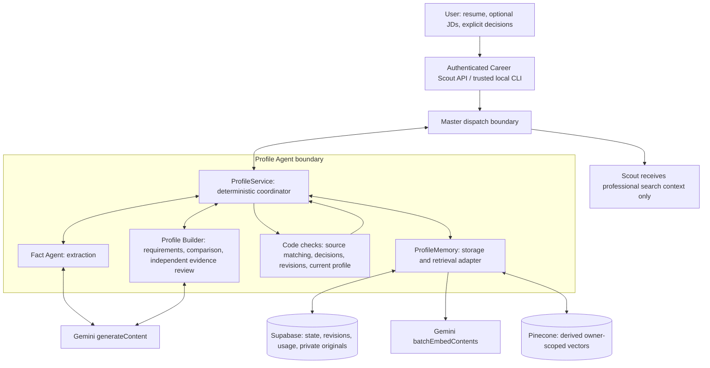
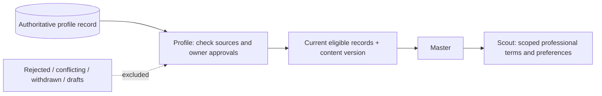

# Profile Agent: design and implementation

Documented November 5, 2026, America/New_York. Baseline: [Career Scout commit cedc267](https://github.com/ujjwalbhateja/Career_Scout/tree/cedc267896578988c2c4607e5cd0877e45e28f39). This document describes inspected code and prompts, not a claim that every provider or deployed environment is currently healthy.

## 1. Purpose and scope

Profile Agent maintains one current factual profile. It takes resume information, coordinates extraction, compares optional employer job descriptions with recorded experience, saves explicit user-confirmed additions and returns eligible professional context to Master.

Its useful output is more than a resume summary: each eligible record retains its identity, version, source quotation, lifecycle and confirmation status. Downstream agents can distinguish what the resume states from what the user later confirms and what remains unknown.

Profile does not discover vacancies, apply to employers, send reminders or rewrite a resume. Career Scout's separate downstream agents handle their respective stages. There is no automatic 70% job handoff in this Profile package. Builder's 75% rule selects useful profile questions; it is not a job match threshold.

The current Career Scout interface has four steps: Resume, Facts, Builder, and Search & shortlisted jobs. The Jobs and Applications header tabs were removed. Profile owns the first three stages and supplies the context for the fourth. The standalone repository provides the same core service through a library and CLI, without reproducing the browser screens.

## 2. Responsibilities and boundaries

| Component | Receives | Produces | Must not do |
| --- | --- | --- | --- |
| Master boundary | User operation or request for a profile | Scoped call to Profile; receives Profile result | Let other agents bypass Profile to read profile memory |
| Profile coordinator | Trusted owner, documents, actions, current revision | Stored decisions, verified save receipts, current-profile packet | Invent evidence, approve on behalf of the user, start research from a save |
| Fact Agent | Resume or substantive answer source segments; supplied factual context | Structured factual proposals with exact source references | Treat a JD as personal experience, invent missing fields, approve proposals |
| Profile Builder | Optional JD requirements, approved facts, source records and earlier decisions | Coverage assessments and focused experience/skill questions | Turn employer requirements into candidate facts or save its own answers |
| Memory adapter | Profile-owned load/save/retrieval operations | Authoritative records, files, derived retrieval results | Treat vector similarity as factual proof |

Fact and Builder do not communicate directly. Profile supplies each stage with a scoped payload and receives its result. Only Profile accesses memory on their behalf. Master remains the top-level coordinator.

## 3. Architecture diagram



The JavaScript service uses small LangGraph child-task graphs to enforce Profile → child → Profile routing. Coordination, approvals, storage, validation and content hashing are implemented in code. They are not delegated to a model choosing arbitrary tools.

## 4. Resume and Fact Agent workflow

1. The trusted caller supplies a resume file or pasted text and the expected storage revision.
2. Code checks document limits, extracts text and assigns stable document/segment identifiers. Supported files are text-based PDF, DOCX and UTF-8 TXT.
3. Profile saves the source and performs the existing Section 1 extraction stage. Full model analysis is a separate action; uploading alone must not be described as completed Gemini analysis.
4. Fact's editable prompt and stage-specific JSON schema guide Gemini over supplied resume/answer segments.
5. Code grounds returned proposals in surviving source quotations, validates records and preserves existing decisions. The extraction stage tracks referenced and unreviewed passages.
6. Profile stores the result. New model proposals are not automatically user-approved. Eligible source-matched resume records may nevertheless be read by the current-profile projection as `source_stated`.

Fact extracts personal details, distinct employment stints, education, certifications, listed skills and professional work assertions. Work assertions retain supported responsibilities, tools actually used, outcomes and scope. Merely listing a tool does not prove a project or years of experience using it.

Code calculates employment durations using supplied date precision and avoids double-counting overlapping periods. It must not infer an absent end date or resolve a two-digit year to an invented century. Derived tenure is not a new approved fact.

Limits in the copied implementation include 2,000,000 file bytes, 60,000 text characters, 800 segments, 80 active documents and at most 25 PDF pages. PDFs containing pages without extractable text are rejected; this implementation does not add OCR.

## 5. Profile Builder workflow

JDs are optional for the factual profile. When supplied, each is retained as employer context. A JD may be uploaded, pasted or read from a supported public link; a title alone cannot establish its requirements. URL intake filters unsafe destinations and removes unrelated page content where it can identify it.

Profile Builder has two separate evidence channels:

| Channel | What it means |
| --- | --- |
| Approved facts | IDs of supplied facts with valid approval; support only their exact confirmed scope |
| Recorded source coverage | Resume/source records, including eligible pending resume statements; prevents asking the same experience question just because approval is pending |

The service extracts JD requirements, then compares them in batches of up to eight. Proposed questions and invalid comparisons receive a separate evidence review in batches of at most two requirements. The second pass receives source candidates and validation issues without the previous score. This is another bounded Builder stage, **not a separate Reviewer Agent** and not Career Scout's downstream Critic.

Code validates component references and calculates weighted coverage: matched weight / total weight × 100. Core components weigh 3 and minor details weigh 1. At 75% or above, a question is skipped only if remaining gaps are minor and no core or critical gap remains. At 50–74%, questions focus on missing material scope. Below 50%, material or critical gaps can be asked; incidental differences may be deferred. Required qualifications are routed to factual review, not invented as work experience.

Questions are grouped into separate Professional Work Experience and Skills tables for each role. Previous decisions are reused. Unresolved comparisons remain explicit and do not become broad approvable claims. A skipped detail remains unconfirmed.

**Current code limitation:** `buildProfiles` checks for at least one approved professional fact before comparison. This is distinct from current-profile search readiness, which can use eligible resume information without repeat approval. The extracted package preserves that check and its existing error message; documentation must not promise a completely approval-free Builder comparison.

## 6. User decision and persistence sequence

```mermaid
sequenceDiagram
    actor U as User
    participant M as Master boundary
    participant P as Profile
    participant B as Profile Builder
    participant R as Memory adapter
    participant S as Supabase
    U->>M: Analyze optional selected JDs
    M->>P: Scoped operation + expected revision
    P->>R: Load owner-scoped source and decisions
    R->>S: Load authoritative state
    S-->>R: State + revision
    R-->>P: Source records and decisions
    P->>B: Requirements + approved facts + source coverage
    B-->>P: Initial comparisons
    P->>B: Independent review of proposed questions / invalid evidence
    B-->>P: Reviewed evidence and unresolved gaps
    P->>R: Save comparison with revision check
    P-->>M: Experience and skills review rows
    M-->>U: Exact statements and available decisions
    U->>M: Approve / Reject / Somewhat
    M->>P: Exact row fingerprint + submission ID
    alt Approve or separately approved revised wording
        P->>R: Save exact statement, evidence and approval
        R->>S: Revision-checked save
        P->>R: Reload authoritative record
        R->>S: Read back
        S-->>P: Stored record via Memory
        P->>P: Verify statement, version, decision and owner approval
        P-->>U: Verified save receipt via Master
    else Reject
        P->>R: Save decision; add no claim
    else Somewhat
        P->>R: Save revised draft; add no approved fact
        P-->>U: Separate approval of exact revised wording required
    end
```

Retries use the same submission ID and payload. Reusing an ID with different decisions is rejected. Row fingerprints and revisions prevent stale approvals. Read-back verification is required before reporting that an approved addition was saved successfully. No extra Save Final Profile action is required by the current workflow.

## 7. Current-profile handoff

`currentProfilePacket` loads existing authoritative records and builds a derived view; it does not create another stored profile or approve records. Eligible information consists of valid owner-approved records, eligible source-matched pending resume records and exact resume work passages supported by the factual view. Rejected, withdrawn, conflicting, missing-source and invalid-approval records are excluded. Unapproved Builder drafts are excluded.

The content version has the form `current-<SHA256>`. Its hash binds the owner, eligible records, professional search profile, search preferences and disclosure preferences. A pinned request fails if this content changes. The packet includes facts, search profile, preferences, source references and a verification receipt.



The full packet can contain personal information and belongs at the trusted coordinator boundary. Scout receives only the professional search context, not raw resumes, contact details or storage credentials. Reading or saving Profile does not start job research.

## 8. Storage and evidence model

| Data | Authoritative location / treatment |
| --- | --- |
| Original uploaded bytes | Supabase private bucket `career-profile-private`, under a hashed owner path |
| Profile state and revision | Supabase `career_profile_states`; revision-checked RPC saves |
| Usage reservations | Supabase `career_profile_usage`; bounded operation reservations |
| Documents and segments | Profile state with IDs, kind, source text, lifecycle and extraction metadata |
| Facts and decisions | Versioned records, evidence quotes, approval references and decision history |
| JD requirements | Employer-only context with separate source evidence |
| Builder reviews/drafts | Profile state; only explicit valid approval adds a confirmed claim |
| Semantic vectors | Derived Pinecone namespace; revalidated against authoritative records |
| Current profile | Computed from current eligible content; legacy snapshots remain compatibility data |

`source_stated`, `user_confirmed` and `independently_verified` have different meanings. A matching quote proves source correspondence, not external truth. User approval confirms wording; it is not independent employment or credential verification. Vector similarity only retrieves candidates for checking.

## 9. Tools, APIs and frameworks used by the implementation

These names and model IDs are read from the pinned code; they are not a current provider-availability or pricing claim.

| Tool / API | Use and implementation |
| --- | --- |
| Node.js 22.13+ / JavaScript modules | Runs the standalone coordinator, CLI and tests |
| `@langchain/langgraph` 1.5.2 | Scoped Profile → Fact/Builder → Profile child execution in `service.mjs` |
| Gemini `gemini-3.1-flash-lite` | Structured Fact extraction, JD extraction and Builder assessments via `/v1beta/models/{model}:generateContent` |
| Gemini `gemini-embedding-001` | Optional 3072-dimensional retrieval vectors via `:batchEmbedContents` |
| Supabase REST RPC | `career_profile_load`, `save`, `reserve`, `purge`, `health`; server-only credentials and owner-scoped arguments |
| Supabase Storage API | Upload, download and delete private original documents |
| Pinecone data API | `/vectors/upsert`, `/vectors/delete`, `/query`; optional derived retrieval index |
| `unpdf` | Extract text from text-based PDFs; original input bytes preserved |
| `fflate` + `fast-xml-parser` | Bounded DOCX archive/XML extraction |
| Native Fetch and Web Crypto | Provider requests, bounded network operations, fingerprints and hashes |
| `node:test` + PGlite | Offline regressions and PostgreSQL migration behavior tests |
| React 19 / TypeScript / Vinext | Career Scout's original browser/API host; not required by this standalone library |

Keenable performs downstream Scout discovery in Career Scout. It is not the model provider for Fact or Builder. No Keenable key is needed for this standalone entry point. Shared Scout-related modules remain in the import closure for existing normalization, JD handling and compatibility; no discovery command is exposed.

## 10. Prompt and implementation map

| File | Responsibility |
| --- | --- |
| `lib/profile/service.mjs` | Current web-runtime coordinator, child tasks, analysis, saves and loaders |
| `lib/workflow/profile-intake.mjs` | Master → Profile intake audit boundary |
| `lib/workflow/policy.mjs` | Allowed communication routes |
| `backend/src/career_scout/agents/fact/prompt.md` | Fact extraction/evidence policy |
| `backend/src/career_scout/agents/profile_builder/prompt.md` | Comparison, independent review, question and decision policy |
| `backend/src/career_scout/agents/profile/prompt.md` | Coordinator responsibility reference |
| `backend/src/career_scout/agents/memory/prompt.md` | Memory responsibility reference |
| `lib/profile/providers.mjs` | Gemini, Supabase and Pinecone adapters and stage schemas |
| `lib/profile/current-profile.mjs` | Current eligible records and content-bound packet |
| `lib/profile/builder-expansion.mjs` | Review rows, exact decisions, replay and approval checks |
| `lib/profile/source-records.mjs` | Valid source and confirmation eligibility |
| `lib/profile/builder-evidence-validation.mjs` | Candidate accounting and evidence consistency |
| `src/index.mjs` | New standalone trusted-library entry point; fixed prompt loading |
| `bin/profile-agent.mjs` | New local CLI with isolated owner identity |

In the original web app, Fact/Builder prompts load from the local Python prompt endpoint when configured, otherwise from build-time bundled Markdown. The standalone library loads the unchanged files from disk for each model stage. Runtime JSON schemas still control outputs; prompt edits do not create permissions or bypass code checks.

## 11. Python graph and extraction boundary

Career Scout also has a Python LangGraph Profile graph and typed Fact/Builder tools. Their tool names are `extract_facts` and `build_profile`. The inspected Python coordinator retains legacy `needs_fact_approval` / `needs_profile_save` states, and its coordinator currently selects Fact or Memory; the Builder node exists but is not selected by that coordinator path. It is not the active implementation of the current browser questionnaire workflow.

This repository therefore extracts the working JavaScript Profile service. It preserves the shared Markdown prompt paths but does not ship an incomplete Python graph as a second runnable Profile system. The `pythonProfileLoader` compatibility conversion remains in the copied JavaScript service.

## 12. Guardrails and known limits

- Owner identity comes from the trusted caller. The original HTTP host authenticates users and enforces same-origin and bounded requests; this local library is not a replacement HTTP authentication service.
- Documents and tool output are untrusted evidence. Exact references and code checks constrain model output; a prompt alone cannot guarantee perfect extraction or defeat every malicious input.
- Storage updates check revisions. Idempotent review operations preserve retries and decisions. Source withdrawal invalidates dependent evidence.
- Model/provider failures remain failures. Truncated or structurally invalid outputs are rejected; bounded evidence review does not authorize infinite retries.
- Semantic search is optional; database retrieval remains available when embeddings or Pinecone are disabled/unavailable.
- Historical Fact comparison found omitted fields/skills and duplicate-record issues. A referenced passage or zero unreviewed passages does not prove complete ingestion. The current package does not claim those quality issues are solved.
- Legacy snapshot/finalization functions remain for compatibility, including older error wording. The standalone public action list omits the retired generated-role and final-save paths; the current-profile loader supplies the current handoff.
- Offline tests establish the tested behavior only. Live provider credentials, model availability, representative resume quality, interactive browser acceptance and hosted deployment are separate checks.

See [setup](SETUP.md), [API](API.md) and [validation](VALIDATION.md) for the executable interface and verification scope.
